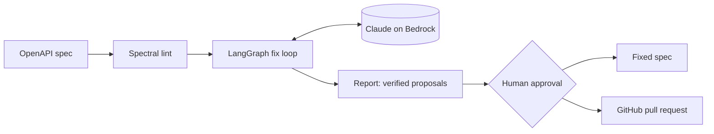
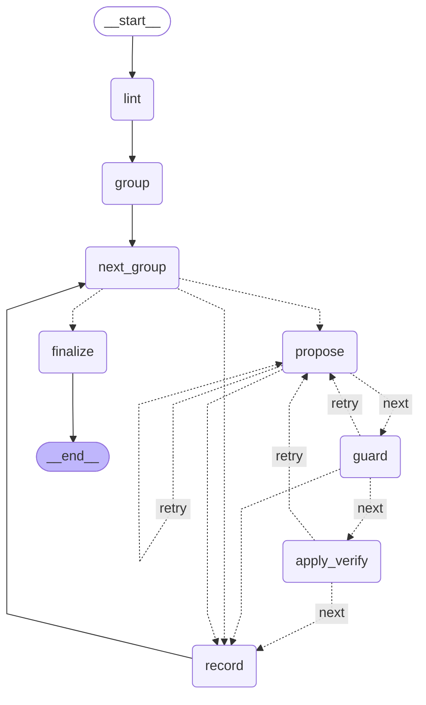

# govagent

**An agent that enforces API governance on OpenAPI specs, and only ships fixes it has verified.**

API guidelines exist in most organizations, but enforcing them is manual: a linter flags
hundreds of violations, then people fix them by hand, inconsistently. govagent closes the loop:

1. **detects** violations deterministically (Spectral + a 13-rule ruleset);
2. has an LLM **propose minimal JSON Patch fixes**, scoped to where each rule allows writing;
3. **verifies** every fix by applying it and re-linting, retrying with precise feedback;
4. separates **safe fixes from breaking ones** (decided by rule metadata, never by the model);
5. lets a human **approve**, then writes the spec or **opens a pull request**.

It runs as a CLI and as an MCP server, so Claude Code or Claude Desktop can drive it.
Built with Python, LangGraph, LangChain (Amazon Bedrock, Claude Haiku 4.5) and the MCP SDK.

<!-- Demo GIF (M8): a client proposes fixes and opens a pull request. -->

Example: [govagent-demo#1](https://github.com/perrinstinct/govagent-demo/pull/1), a pull request
opened by govagent on a deliberately messy spec: four safe fixes applied (+6 −1 lines, comments
untouched), three breaking fixes verified but left for explicit approval, one item that needs a
human (a contact email the agent will not invent).

## Results

84 eval cases (60 single-violation, 24 with 3–5 violations), 152 violations injected into
hand-written lint-clean specs by deterministic mutators. Claude Haiku 4.5 on Bedrock (eu-west-3):

| | First run | After fixing the prompt |
|---|---|---|
| **Fix rate** | 96.7% (147/152) | **100% (152/152)** |
| **Regressions** (new violations in the final spec) | 0% | 0% |
| Valid OpenAPI after fixes | 100% | 100% |
| Attempts per fix | 1.07 | 1.03 |
| **Cost per case** | $0.0047 | **$0.0048** |
| Latency p50 / p95 | 2.6 s / 12.1 s | 2.4 s / 11.1 s |

The five first-run failures had a single cause, found by reading the recorded model calls: JSON
Pointer escaping (the HTTP method glued into the path key, or a stray `/` after a key ending in
`~1`). Naming both traps in the system prompt fixed all five; the verification step had
rejected every faulty attempt in the meantime, hence 0% regressions in both runs. Results, per
rule breakdown and every recorded call: [`evals/results/`](evals/results/).

## How it works



The fix loop is a LangGraph state machine (generated from the compiled graph):

<!-- agent-graph:start -->

<!-- agent-graph:end -->

- **lint / group**: violations are grouped by rule and scope (one operation, one schema...).
- **propose**: one structured-output call per group, with the rule's guidance, the allowed write
  scopes and a bounded YAML fragment, never the whole spec.
- **guard**: operations outside the allowed scopes are rejected before anything is applied.
- **apply_verify**: apply on a copy, check the result is still valid OpenAPI, re-lint, compare.
  A failure goes back to `propose` with precise feedback (up to 3 attempts).
- **record**: a resolved fix becomes the base for the next groups; groups are recomputed because
  a fix can move pointers (a path rename moves every operation under it).

Budgets (attempts per group, model calls and dollars per run) are enforced in code.

## Design decisions

- [ADR 001](docs/adr/001-deterministic-detection-llm-fixes-only.md): deterministic detection, the LLM only fixes
- [ADR 002](docs/adr/002-json-patch-over-full-rewrite.md): JSON Patch over full rewrite
- [ADR 003](docs/adr/003-approval-outside-the-graph.md): human approval lives outside the agent graph
- [ADR 004](docs/adr/004-deterministic-breaking-classification.md): breaking-ness and fix class are deterministic

## Quickstart

Requires [uv](https://docs.astral.sh/uv/), Node.js (for Spectral) and AWS credentials with
access to an Anthropic model on Amazon Bedrock.

```bash
uv sync
npm i -g @stoplight/spectral-cli@6.16.3
cp .env.example .env   # model id, region, prices; GitHub token and allowlist for PRs
```

```bash
uv run govagent lint path/to/openapi.yaml
uv run govagent fix path/to/openapi.yaml --interactive      # review each diff, approve or skip
uv run govagent fix path/to/openapi.yaml --yes-non-breaking # apply only safe fixes
uv run govagent pr --repo OWNER/NAME --path openapi.yaml --interactive
```

### As an MCP server

```bash
GOVAGENT_MCP_API_KEY=change-me uv run govagent serve --port 8765
claude mcp add --transport http govagent http://127.0.0.1:8765/mcp --header "Authorization: Bearer change-me"
```

Tools: `lint_spec`, `propose_fixes`, `apply_fixes`, `open_pull_request`. Bearer token on every
route but `/healthz`, per-key rate limit, DNS-rebinding protection, analyses kept in memory
for one hour.

## Limitations

- Single-file specs only: external `$ref`s are rejected.
- The agent fixes what the 13 rules can express; semantic quality (useful descriptions) is out
  of scope.
- Explicit `null` / `~` values come back as empty values; added nodes follow ruamel's default
  style (block lists, single quotes) rather than the file's.
- Breaking-ness is per rule, not per change: conservative by design.
- Evaluated on one model (Claude Haiku 4.5), on hand-written specs.
- The MCP analysis store is in memory: one process, one hour.

## Roadmap

AWS deployment (two Terraform stacks, the service started only for demos) · Claude Haiku 5.5
eval run · added nodes styled like the rest of the file · LLM-assisted rules from written
guidelines · breaking-change detection between versions (oasdiff) · multi-file specs ·
GitHub App authentication · GitHub Action wrapper.

## Development

```bash
uv run ruff check . && uv run ruff format --check .
uv run pyright
uv run pytest                  # unit tests: no Spectral, no network
uv run pytest -m integration   # needs Spectral on PATH
uv run python -m evals.run --subset smoke   # real Bedrock calls, capped by --max-total-cost
```

Specification: [docs/SPEC.md](docs/SPEC.md).

## License

[MIT](LICENSE)
